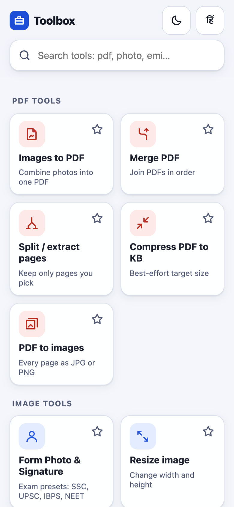
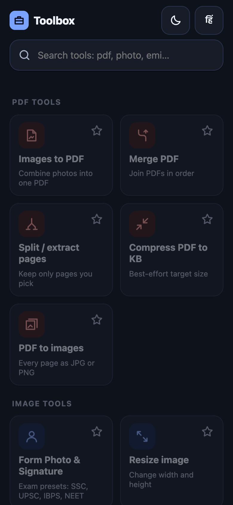
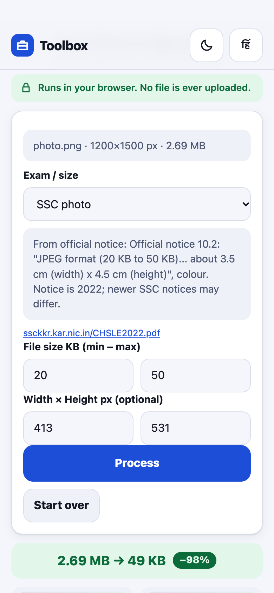
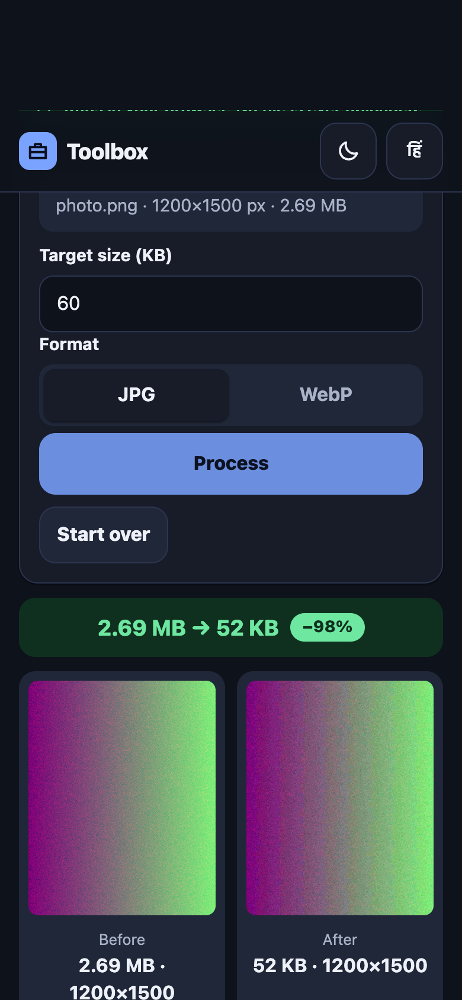
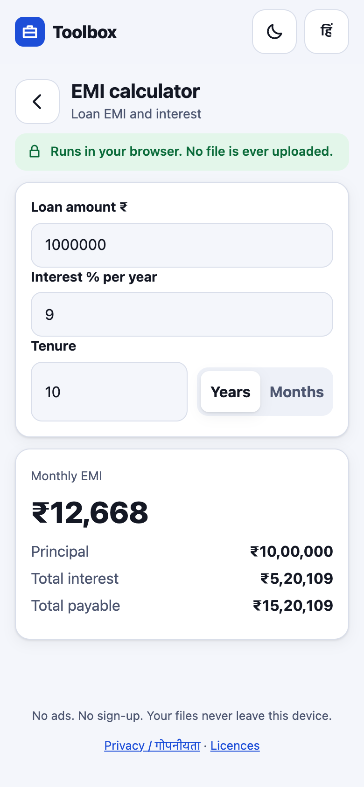
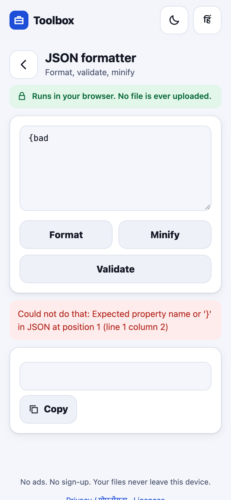

# Toolbox

Free web tools for everyday paperwork: PDF, photos, exam-form photo and signature sizes, developer utilities and Indian calculators. English and Hindi. Works offline once loaded.

**Live: https://surajrajput1024.github.io/toolbox/**

<p>






</p>

## Privacy promise

**Nothing is uploaded.** Every tool runs in your browser. Your files, photos and text never leave your device: no server, no account, no analytics, no tracking. You can verify this in the browser network tab or by reading the source. See [privacy.html](privacy.html).

## Tools

| Group | Tools |
|---|---|
| Photo | Form photo and signature (SSC, UPSC, IBPS, NEET, RRB, passport presets), resize, compress to a target KB, convert JPG/PNG/WebP, crop and rotate, signature resize |
| PDF | Images to PDF, merge, split or extract pages, compress to a target size (best effort), PDF to images |
| Developer | JSON formatter, Base64, URL encode/decode, JWT decoder, hash generator, UUID, Unix timestamp, regex tester, text diff |
| Text | Word and character count, case converter, remove extra spaces |
| India calculators | Age, EMI, GST, percentage, SIP |

## Run locally

Requires Node 20+.

```sh
npm ci
npm test          # fast logic tests
npm run build     # builds the site into dist/
npm run serve     # build and serve at http://localhost:8080
npm run test:e2e  # browser tests (needs Chrome; set CHROME_PATH if not auto-detected)
```

For quick development you can also serve the repository root with any static server (for example `npx http-server .`) and open `index.html`.

## How it is built

Plain HTML, CSS and JavaScript with no framework and no bundler. `tools/build_site.js` copies the app and generates one page per tool, the exam landing pages, `sitemap.xml` and `robots.txt`. A GitHub Actions workflow tests, builds and deploys `dist/` to GitHub Pages on every push to `main`.

## Add a tool

1. Register metadata in `js/tools.js` (one `T(...)` line).
2. Implement it in the matching module under `js/tools/` with `TB.register('<id>', (el) => { ... })`.
3. Put pure logic in `lib/logic.js` and add a test in `test/logic.test.js`.

Details and the PR checklist are in [CONTRIBUTING.md](CONTRIBUTING.md). Look for issues labelled [good first issue](../../labels/good%20first%20issue).

## License

[MIT](LICENSE) © Suraj Singh Rajput. Bundled third-party libraries are listed in [LICENSES.md](LICENSES.md).
